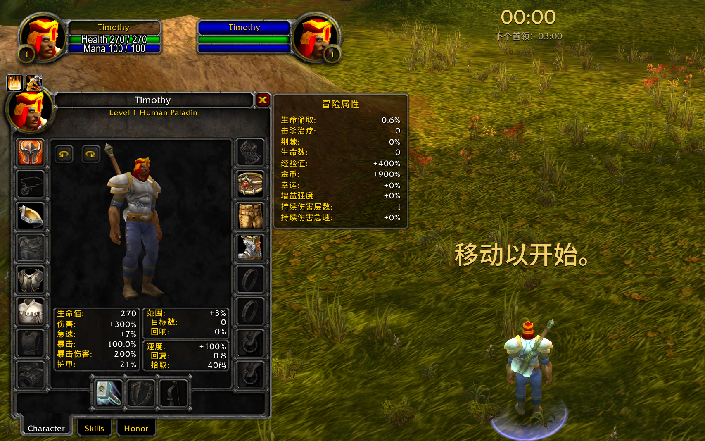

# Azeroth Survivors Trainer

单机内存修改器，针对 **Azeroth Survivors**（Rust + Bevy 重写的 WoW 1.12 客户端）。

修改器（`trainer.py` / `player.py` / 界面）纯内存读写：**不改存档、不改 exe、不注入代码**，退出游戏即完全还原。
唯一的例外是单独的 [`save.py`](#存档工具会改存档)：它改的是存档文件，只在游戏关闭时运行，每次先备份。

## 已验证版本

`v0.2.0-1118`（2026-11-04 实测：属性块全部字段、金币/血量/等级/经验/击杀/重抽/宝箱价格均与游戏 HUD 一致，放逐次数与实际放逐次数一致）。

游戏更新后偏移可能需要重新定位，见 [docs/UPDATING.md](docs/UPDATING.md)。

## 能做什么

| 层 | 脚本 | 改什么 | 会不会被覆盖 |
|---|---|---|---|
| **状态层** | `player.py` | 金币、当前血量、最大血量、等级、经验、击杀、重抽次数、放逐次数、宝箱价格 | 不会，写的是游戏真实状态 |
| **属性层** | `trainer.py` | 18 项运行时属性（伤害、暴击、暴伤、急速、移速、拾取、范围、经验倍率、护甲、回复、幸运、金币倍率、额外目标数、回响、击杀治疗、增益强度、持续伤害急速…） | 会，升级重算会覆盖，需要 `--pin` |

`--pin` 每次写入前都会重新校验目标：如果那块内存不再像属性块（这局结束了、内存被复用），就停止写入，不会往无关内存里乱写。



## 图形界面（推荐）

双击仓库根目录的 **`gui.bat`**（需要已安装 uv），或者：

```bash
uv run --no-project --with numpy python src/gui.py
```

1. 进入一局后点 **定位游戏**，等 30～90 秒扫描完成。
2. **左边“属性”**：输入数值，勾 **锁定**（或直接按回车）就持续生效；游戏每 1～3 秒会重算这些值，不锁定写了也会被改回去。
3. **右边“状态”**：输入数值点 **写入**（或回车）；金币、血量、重抽、放逐、宝箱价格还能勾 **锁定**，比如宝箱价格锁在 1。
4. 锁定中的当前值显示为绿色。游戏会在局中把角色数据搬到内存别处（Bevy 引擎在角色增减组件时整体搬迁），
   这时会自动重新定位、锁定保留；真连不上了（游戏关了、对局结束）才需要再点一次定位。
5. **下面“存档”**（就是 [`save.py`](#存档工具会改存档)）：特权重置清零、改各职业的印记。
   游戏开着时这里只读、按钮是灰的；**完全退出游戏**后自动变成可改，每次写入都会先备份。

## 游戏内控制器

不想切出游戏的话，用游戏内面板：

1. 双击仓库根目录的 **`remote.bat`**（游戏开没开都行）。它会把插件 `AZSRemote` 装进
   `benilla-config\AddOns`（第一次装或有更新时），然后在后台等游戏。
2. **开一局新冒险**（插件在开局时加载），点屏幕左侧的 **AZS** 按钮（或输入 `/azs`）打开面板。
   按钮可以拖到任意位置，位置会被游戏记住；颜色就是后台状态：红 = 后台没开，黄 = 定位中，绿 = 已就绪。
3. 状态显示“定位中…”约 30～60 秒，变绿色“已就绪”后：属性填数值按回车或勾“锁”；状态字段点“写”，能锁的也可以勾“锁”。
   下面有“回满血”“全部解锁”“重新定位”。
4. 角色在内存里换了位置时，后台自动重新找到它，锁定自动接上（面板短暂变黄）。
5. 游戏关闭后后台继续等，下次开游戏自动连上；关掉 `remote.bat` 窗口才真正退出，所有锁定随之停止。

**为什么要单独开一个后台程序**：插件的 Lua 是彻底的沙箱（`io/os/require/package/debug/dofile/loadlib` 全是 nil，
局内也没有 `LaunchURL`），既改不了数值，也启动不了外部程序。所以反过来，由后台程序在内存里找到插件的“信箱”
（一个以三个魔数开头、等间距存放的数字数组），读插件写进去的命令、执行、再把结果和当前数值写回去，插件只负责显示。
协议见 [`src/addon_mailbox.py`](src/addon_mailbox.py)。

## 命令行

```bash
pip install numpy

# 看状态
python src/player.py --show

# 改钱 / 回血 / 无限重抽 / 宝箱价格
python src/player.py --gold 999999
python src/player.py --heal
python src/player.py --rerolls 99
python src/player.py --chest 1      # 下一个宝箱只要 1 金币（开完游戏会照常涨价，想再便宜就再改一次）

# 改属性（持续生效）
python src/trainer.py --pin dmg=4.0 --pin luck=5.0
```

游戏需要先启动并**进入一局**（不在菜单、人还活着）。脚本会自动定位进程和对象。

`--pin` 启动后要先扫两遍内存（30～90 秒，会打印进度），出现 `pinning every 0.02 s` 才开始写入，窗口关掉就停。
游戏每 1～3 秒会重算一次属性，pin 每 0.02 秒写回一次，面板偶尔闪回原值不超过约一帧（`--interval` 可调）。

## 存档工具（会改存档）

局外的进度（特权重置次数、印记、特权、成就、收藏……）都在存档 `%APPDATA%\wenilla-rogue\characters.txt` 里，内存修改器管不到。
`save.py` 能解密、修改、重新加密它：

```bash
python src/save.py --show                 # 解密并打印存档（只读）
python src/save.py --resets 0             # 特权重置次数恢复满（存的是“已用次数”）
python src/save.py --marks 9999.9         # 当前职业的印记（升级装备用）
python src/save.py --marks 500 --cls 5    # 指定职业，职业编号同 WoW：2 圣骑士、5 牧师……
python src/save.py --export plain.txt     # 导出明文，手工改完再
python src/save.py --import plain.txt     # 加密写回
```

- **必须先完全退出游戏**：游戏退出时会用内存里的数据重写存档，开着游戏改会被覆盖。工具检测到游戏在运行会拒绝写入。
- 每次写入前自动备份到存档旁边的 `trainer-backups\`，写完立即解密回读，只允许预期的那几行发生变化，否则自动还原备份。
- 加 `--dry-run` 只显示改动、不写入。
- 密钥不在本仓库里：每次运行时从游戏 exe 里找，并且要能验证当前存档才会使用。游戏换了存档格式时工具会报错退出，不会写出坏存档。

存档格式和各字段含义见 [docs/SAVE.md](docs/SAVE.md)。

## 原理

**两层结构**，这是本项目最核心的认知：

- 属性层改的是一块 `f32` 缓存（`hp/dmg/cd/crit/cm/spd/pick/xp/arm/?/reg/area/luck/gold` 共 20 个槽位），
  它会被游戏重算覆盖，所以必须高频重写（`--pin`）。
- 状态层改的是**玩家对象本体**（几 KB 的大结构），金币、血量、重抽、放逐、宝箱价格都在里面，写入即真实状态。

**定位不靠固定地址**，而是：

1. 用属性块的**结构指纹**（多个字段同时落在合理区间）找候选；
2. 用 HUD 里游戏自己打印的**击杀数 / 金币**交叉验证。

这样即使每次启动地址不同、甚至版本小更新，也能稳定定位。

偏移表见 [docs/OFFSETS.md](docs/OFFSETS.md)；代码里所有偏移只在 [src/offsets.py](src/offsets.py) 一处定义。

## 目录结构

| 文件 | 作用 |
|---|---|
| `src/offsets.py` | **所有偏移和合理区间**，游戏更新后只改这里 |
| `src/memscan.py` | 通用 x64 进程内存读写 + 分块扫描（也能单独当命令行用） |
| `src/game.py` | 找游戏进程、读取 HUD 数据 |
| `src/player.py` / `src/trainer.py` | 状态层 / 属性层命令行工具 |
| `src/gui.py` / `src/session.py` / `gui.bat` | 图形界面 / 界面背后的定位、读写、锁定逻辑 / 双击启动 |
| `src/verify_layout.py` | 只读自检：偏移还对不对 |
| `src/scan_stores.py` / `src/group_stores.py` | 从 exe 里重新扫属性写回点（纯标准库） |
| `src/diffscan.py` | 差分扫描，找未知字段 |
| `src/save.py` | 存档解密 / 修改 / 加密（**会改存档**，只在游戏关闭时运行） |
| `addon/AZSRemote/` | 游戏内控制器插件（Lua，`/azs`），由 `agent.py` 自动安装 |
| `src/agent.py` / `src/addon_mailbox.py` / `remote.bat` | 控制器后台 / 和插件通信的内存信箱协议 / 双击启动 |
| `tests/` | 离线测试，用假内存模拟进程，不需要开游戏 |

## 测试

```bash
uv run --no-project --with numpy --with lupa python -m unittest discover -s tests -v
```

`lupa` 提供一个 Lua 5.1，用来在假的 WoW 界面 API 上直接跑插件，测“点面板 → 信箱 → 后台执行 → 面板显示”的完整来回；
不装 `lupa` 时这几个测试自动跳过。

## 版本更新后

```bash
python src/verify_layout.py      # 先自检：偏移还对得上吗
```

对不上时，`scan_stores.py` + `group_stores.py` 会重新从 exe 里扫出属性写回点。
完整流程见 [docs/UPDATING.md](docs/UPDATING.md)。

## 已知限制

- **生命偷取 / 荆棘 / 生命数** 改不了：它们不存成数值，是每次从装备/天赋现算的（已验证：`0.006` 在整个进程里连精确的 float32 都不存在）。
- **极速模式**没做：需要注入 DLL 钩 `QueryPerformanceCounter`，风险高。环境变量 `WOW_FIXED_DT` 只影响动画时钟，不影响游戏速度（已实测 1.00x）。
- 只支持单人模式；联机不碰。

## 免责声明

- 仅供**单机自用**。请勿用于联机/合作模式，那会影响其他玩家。
- 仓库**不包含任何游戏资源**（MPQ、exe、美术资源）。
- 游戏更新后需自行重新定位偏移；不保证长期可用。
- 使用风险自负。

## 许可

MIT — 见 [LICENSE](LICENSE)。

## 参考

- 计时 API 缩放（未实现）的思路参考 [OpenSpeedy](https://github.com/game1024/OpenSpeedy)（GPL-3.0，本仓库未包含其代码）。
- 指令级结构定位的思路参考 iced-x86 反汇编器的用法（本仓库用机器码形态匹配代替，不依赖反汇编库）。
